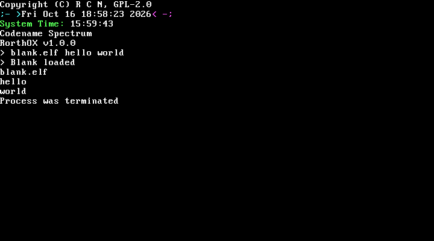
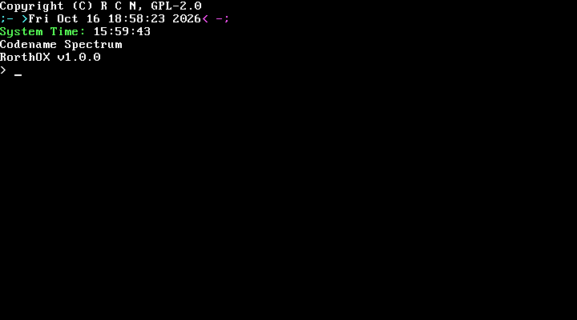
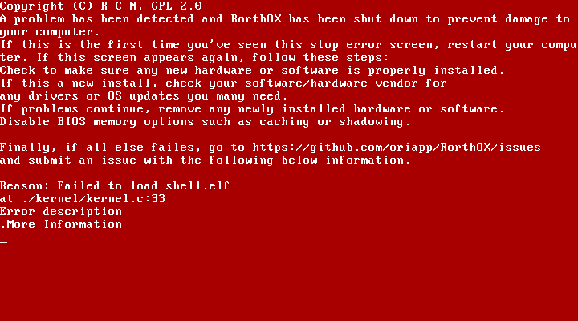
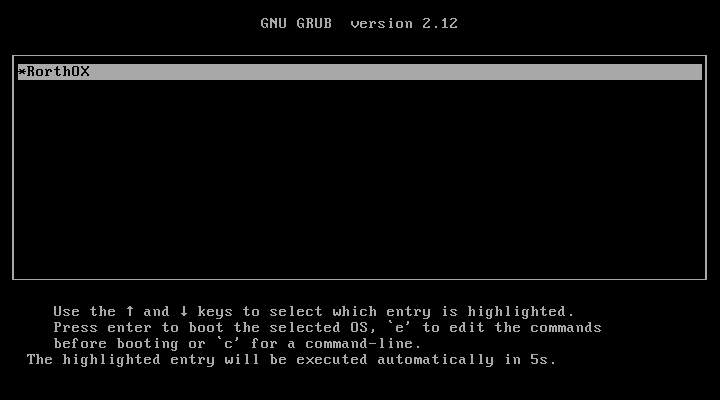

# RorthOX

RorthOX is my hobby operating system for 32-bit x86, written in C (gnu99, freestanding) and NASM. It boots from its
own boot sector or through GRUB and runs a small shell and user programs in ring 3, with paging, a FAT16 disk that
programs can read and write, ELF loading, preemptive task switching and `int 0x80` syscalls. It's a learning project: small and
readable comes first, and it runs in QEMU (it has never been tried on real hardware).



| Boot | Kernel panic (here: no `shell.elf` on the disk) |
|---|---|
|  |  |



## What works

Everything in this list is checked by `make test` or was run in QEMU.

- **Boot:** a 512-byte boot sector with a FAT16 BPB sets up a flat GDT, enters protected mode and loads the kernel
  with ATA PIO to 1 MiB. The kernel clears its own `.bss` before any C code runs.
- **GRUB boot:** the same `kernel.bin` carries a Multiboot 1 header, and `make iso` builds a BIOS GRUB ISO with a
  one-entry menu. Programs still come from the FAT16 disk image.
- **CPU setup:** GDT with kernel/user code and data segments plus a 104-byte TSS, a 256-vector IDT, both 8259 PICs
  remapped (IRQs at 0x20-0x2F, only timer, keyboard and cascade unmasked), PIT at 100 Hz (divisor 11932, rounded
  up so a tick is never shorter than 10 ms of the nominal clock).
- **Exceptions:** a CPU exception in a user program ends only that program and the shell keeps working. An exception
  in kernel code stops the machine with a panic screen showing the reason and `file:line`, and one line on the debug
  port.
- **Memory:** a block allocator for the kernel heap (100 MiB, 4 KiB blocks) that refuses requests it can't satisfy, and
  one paging directory per process. User `malloc` clears every byte of its backing pages, including trailing padding.
  Programs that exit give their memory back.
- **Disk:** ATA PIO (LBA28) with polling and status checks: reads, writes (WRITE SECTORS), FLUSH CACHE, and IDENTIFY
  DEVICE to find out whether and how far the disk can be written.
- **FAT16:** a path parser (`0:/dir/file`), a small VFS and a FAT16 driver with 8.3 names, subdirectories and cluster
  chains. It can create files in existing directories, truncate them, overwrite them in place and append to them.
  Every change goes to the disk in a fixed order with a flush after each step (see
  [Writing files](#writing-files)), and both FAT copies are kept the same.
- **Files from programs:** syscalls 13-18 open, read, write, seek, stat and close files. Each process has its own
  16 handles, which are closed when it exits or faults. A file written this way stays on the disk image and can be
  read back after a reboot, and a program copied this way can be run from the shell.
- **Programs:** ELF32 executables (each load segment gets its own zeroed memory, mapped writable only when the segment
  is) and flat binaries up to 1 MiB, loaded at 0x400000 and run in ring 3 with their own 16 KiB stack. Program page
  padding is zeroed before the program runs. Checked syscall copies still accept only the requested allocation bytes,
  raw file bytes, ELF segment bytes and the stack, not page padding.
- **Process memory isolation:** ring 3 can access only its own program pages, stack pages and live allocation pages.
  Kernel memory and other processes' backing pages are supervisor-only. Permissions work in 4 KiB pages, so a program
  can access its own zeroed page padding directly, though syscalls reject that padding. CR0.WP is on, so the kernel
  also faults when it writes to a read-only mapping, such as a program's read-only ELF pages. (Syscalls don't write
  through program mappings at all: their copies check the target's permissions first and refuse read-only memory.)
- **Tasks:** 12 process slots, a round-robin task switch on every timer tick, command-line arguments passed to
  `main(argc, argv)`.
- **Sleeping:** a program can call `sleep(milliseconds)` (syscall 12). Only that program blocks: the scheduler skips
  it and the other tasks keep running, and the timer tick wakes it once its deadline has passed. It comes back with
  its registers and stack as they were and gets 0. When every task is asleep, the kernel halts the CPU (`hlt` with
  interrupts on) until a tick makes one due; keys and other interrupts that come in meanwhile go back to the halt.
- **Syscalls:** 20 calls through `int 0x80` (table below). Every argument and every string or list a syscall reads
  from user memory goes through a checked copy: only memory the program owns and has mapped, so a bad pointer can't
  crash the kernel. The call fails instead and the program carries on. A file read or write checks the whole buffer
  before it touches the disk.
- **Console:** 80x25 VGA text with colours, scrolling and backspace across rows, and a kernel `printf`. Programs can
  move the cursor back and forth across rows without changing the text (syscall 11); a move off the visible page is
  refused. Kernel debug output also goes to port 0xE9 (QEMU's `debugcon`).
- **Keyboard:** PS/2 scancode set 1 with Shift symbols, Caps Lock and the keypad. Num Lock starts on, so the keypad
  types digits right away as before, whatever state the BIOS or GRUB left the keyboard in. The driver keeps track of
  it: with it off, the keypad digits and the decimal point type nothing, while keypad `+ - * /` and Enter still work. The arrows, Home, End, Insert, Delete, Page Up and Page Down arrive as their own key codes,
  0x100-0x109 (`KEY_*` in `config.mk`), whatever the Num Lock state. Print Screen and Pause type nothing.
- **Shell:** reads a line, splits it into words and runs the first word as a program (`blank.elf hello world`).
  While typing, Left/Right, Home/End, Backspace and Delete work anywhere in the line; Up, Down, Insert and the page
  keys are ignored. There are no built-in commands.
- **Program lookup:** syscalls 6 and 7 (and so the shell) look a bare program name (no `/` or `:`) up in the
  directories of `PROGRAM_SEARCH_PATHS` in `config.mk`, in order: by default `0:/` and then `0:/bin/`. The first
  directory that has the file wins. Only "not found" moves on to the next directory; a name that is there but can't
  be loaded (a directory, a broken ELF file, an empty or too big raw program) stops the lookup with an error. A name with a `/`
  or `:` is tried once, relative to `0:/` (`bin/x.elf` means `0:/bin/x.elf`; a drive prefix like `0:/x.elf` isn't
  understood). Names can be up to 104 characters, and `argv[0]` is the name as typed, not the full path. The image
  the build makes has no `bin/` directory: `shell.elf` and `blank.elf` are in the root.
- **User library:** `programs/stdlib` with the syscall wrappers, `malloc`/`free`, `printf`, `strtok`, `itoa`
  and a line reader with the editing keys above (`rorthox_terminal_readline`).

## Architecture

### Boot flow

The default path is my own boot sector:

1. The BIOS loads the boot sector (`kernel/boot/boot.asm`) to 0x7C00.
2. It loads a flat GDT, sets CR0.PE and far-jumps to 32-bit code.
3. It reads the kernel area (sectors 1-199, `RESERVED_SECTORS - 1`) from the primary ATA disk with PIO to 0x100000
   and jumps there.
4. `_start` (`kernel/kernel.asm`) loads the data segments, sets the stack to 0x200000, turns on A20 (port 0x92),
   clears `.bss`, remaps and masks both PICs and calls `kernel_main`.
5. `kernel_main` (`kernel/kernel.c`) sets up the terminal, GDT, kernel heap, filesystems, disk, IDT, PIT, TSS and
   paging, registers the syscalls and the keyboard, loads `0:/shell.elf` and drops into ring 3 with `iret`.

Interrupts stay off while the kernel runs. They are on only in user mode (`task_return` sets EFLAGS.IF), so every
timer tick, key press and syscall enters the kernel from ring 3. The one exception is the idle loop in `task_next`:
when every task sleeps, it runs `sti; hlt; cli` (`IRQ_ON_AND_PAUSE`) in ring 0 and looks for a runnable task again
after each return. An interrupt that arrives there comes from ring 0, so the kernel saves no task state for it and
keeps its own page directory: the timer tick only counts and wakes sleepers, and the loop picks the next task itself.

The second path is GRUB (`make iso`, `./qemu.sh --iso`):

1. BIOS GRUB 2 boots from the CD and shows a menu with one entry and a 5-second timeout
   (`kernel/boot/grub.cfg.in`). The entry runs `multiboot /boot/kernel.bin`.
2. `kernel.bin` is still a flat binary. Its Multiboot 1 header (in `kernel/kernel.asm`, inside the first 8 KiB,
   checked by the linker script) uses the address fields, so GRUB loads the whole file at 0x100000, zeroes up to
   the end of `.bss` and jumps to `multiboot_entry`.
3. `multiboot_entry` checks the magic value in EAX, loads its own copy of the flat GDT, far-jumps to the kernel
   code segment, loads the data segments and sets the stack to 0x200000.
4. It then jumps to `kernel_boot_init`, the point in `_start` right after the A20 write (GRUB already turned A20
   on). From there both paths run the same code: clear `.bss`, set up the PICs, `kernel_main`.

The ISO holds only GRUB, `kernel.bin` and `grub.cfg`. Programs still come from the FAT16 disk `bin/os.bin`, which
has to be attached as the primary ATA disk. The Multiboot information GRUB passes in EBX isn't used yet.

### Memory map

Addresses below are physical unless marked virtual. The kernel directory has a supervisor-writable identity map of
all 4 GiB. Each process owns a separate directory and page tables with the same supervisor defaults, overlaid with
user mappings only for its program, stack and live allocations. User access requires permission in both the directory
entry and the individual page entry. Freeing an allocation restores supervisor-writable identity pages before reuse;
it does not leave holes in the kernel mappings needed during entry and return.

| Address | What |
|---|---|
| 0x7C00 | boot sector |
| 0x7E00-0xE1FF | kernel heap block table (one byte per 4 KiB block) |
| 0xB8000 | VGA text screen |
| 0x100000-0x111B57 | kernel image (`kernel.bin`, 72,536 bytes; the disk reserves 101,888) |
| 0x112000-0x11464B | kernel `.bss` |
| below 0x200000 | kernel boot stack (top 0x200000) |
| 0x3FB000-0x3FEFFF | user stack (virtual, 16 KiB, top 0x3FF000) |
| 0x400000-0x4FFFFF | user program load window (virtual) |
| 0x500000-0x5FFFFF | kernel stack for interrupts from ring 3 (TSS `esp0` = 0x600000); the idle loop runs on it too, there is no separate idle stack |
| 0x01000000-0x073FFFFF | kernel heap (100 MiB), so the machine needs 128 MiB of RAM |

The values shared between C, NASM, the linker scripts and the shell scripts live in one place, `config.mk`: among
others the syscall numbers and the codes of the special keys (`KEY_UP` = 0x100 to `KEY_PAGE_DOWN` = 0x109). It also
holds the program search list, `PROGRAM_SEARCH_PATHS`: 1 to 4 directory prefixes such as `0:/` or `0:/bin/`
(`0:/`, then simple directory names, each ending in `/`; disk 0 is the only disk). The build stops on anything else.

### Disk image

`bin/os.bin` is the boot sector, then `kernel.bin`, then 16 MiB of zeroes. The FAT16 layout comes from `config.mk`:

| Sectors | What |
|---|---|
| 0 | boot sector with the BPB |
| 1-199 | kernel area (`kernel.bin`; the build fails if it doesn't fit) |
| 200 onwards | FAT 1 and FAT 2 (256 sectors each), root directory, data |

The build copies `shell.elf` and `blank.elf` into the root directory with mtools, so no root access is needed,
and marks them read-only: opening them for writing or appending returns `-ERDONLY`. To replace one in an image,
clear the flag first (`mattrib -i bin/os.bin -r ::shell.elf`).

A cluster is 64 KiB (128 sectors) and the root directory has 64 entries. The BPB describes a volume of about 4 GB
(that's what `mdir` reports as free), but the image file is only about 16 MiB. Before its first write, the kernel
asks the disk for its real size (IDENTIFY) and only ever allocates whole clusters that fit inside it. On the image
the build makes right now (16,850,264 bytes) that is clusters 2 to 252, about 15.7 MiB; the image doesn't grow.

### Subsystems

| Directory | What's in it |
|---|---|
| `kernel/boot` | boot sector, GRUB menu template |
| `kernel/kernel.asm`, `kernel/kernel.c` | entry points (`_start` and `multiboot_entry`), PIC setup, `kernel_main`, panic |
| `kernel/gdt`, `kernel/idt`, `kernel/task/tss.*` | descriptor tables, 256 interrupt stubs, TSS |
| `kernel/arch/i686` | VGA terminal and `printf`, debug port, panic screen, PIT driver (tick counter, milliseconds to ticks) |
| `kernel/memory` | heap allocator (`heap/`), paging (`paging/`) |
| `kernel/disk` | ATA PIO driver (read, write, flush, IDENTIFY) and byte streamer |
| `kernel/fs` | path parser, VFS, FAT16 (reading and writing) |
| `kernel/loader/formats` | ELF32 loader |
| `kernel/task` | tasks, processes, switching to ring 3, sleeping tasks and the idle loop |
| `kernel/isr80h` | the syscalls (file syscalls in `file.c`) |
| `kernel/keyboard` | keyboard queue and the PS/2 driver |
| `kernel/time/rtc` | CMOS clock read at boot ("System Time") |
| `include/rorthox` | headers shared by the kernel and programs: file modes, the stat struct, error codes |

### Syscalls

A program puts the number in `eax`, pushes the arguments and runs `int 0x80`; the result comes back in `eax`. The
numbers are in `config.mk`, the handlers in `kernel/isr80h/`, the wrappers in `programs/stdlib/src/rorthox.asm`.

| # | User function | What it does |
|---|---|---|
| 0 | (no wrapper) | returns the sum of two integers |
| 1 | `print(str)` | prints a string (copied through a 1 KiB kernel buffer) |
| 2 | `rorthox_getkey()` | next key from the process's keyboard queue: a byte (1-255) or a special key code (0x100-0x109), 0 if there is none |
| 3 | `rorthox_putchar(c)` | prints one character |
| 4 | `rorthox_malloc(size)` | allocates kernel heap memory and maps it into the process |
| 5 | `rorthox_free(ptr)` | frees an allocation of the process |
| 6 | `rorthox_process_load_start(name)` | finds the program (see program lookup above), loads it and switches to it |
| 7 | `rorthox_system(args)` | runs a command from a list of arguments; the first word is looked up the same way (at most 32 words, program name included) |
| 8 | `rorthox_process_get_arguments(out)` | writes `argc`/`argv` into a writable struct the process owns |
| 9 | `rorthox_exit()` | ends the process |
| 10 | `printc(str, colour)` | prints a string in one of the 16 VGA colours |
| 11 | `rorthox_terminal_move_cursor(delta)` | moves the screen cursor by `delta` cells (negative = back, across rows) without changing the text; a move off the 80x25 page returns an error and changes nothing, it never scrolls |
| 12 | `sleep(milliseconds)` | blocks the calling program for at least that many milliseconds while other tasks run, then returns 0; 0 returns 0 at once, a negative value returns `-EINVARG` (-2) without sleeping |
| 13 | `rorthox_open(path, mode)` | opens a file and returns a handle (1-16) |
| 14 | `rorthox_read(fd, buffer, count)` | reads up to `count` bytes, at most 4096 per call; returns the number read, 0 at the end of the file |
| 15 | `rorthox_write(fd, buffer, count)` | writes up to `count` bytes, at most 4096 per call; returns the number written |
| 16 | `rorthox_seek(fd, offset, whence)` | moves the position (`RORTHOX_SEEK_SET`/`CUR`/`END`, signed offset) and returns it |
| 17 | `rorthox_stat(fd, out)` | writes the file's size and flags (bit 0: read-only) into a `struct rorthox_file_stat` |
| 18 | `rorthox_close(fd)` | closes a handle |
| 19 | `rorthox_get_ticks()` | returns delivered timer ticks since boot as a `uint32_t`, with no arguments |

`sleep` takes milliseconds, not seconds like POSIX `sleep`. The kernel turns them into timer ticks:
`ceil(ms / 10) + 2` at 100 Hz. The two extra ticks cover a tick that may already be pending when the sleep starts
and the partial tick that is running, so the whole ticks that follow add up to at least the time asked for, counted
in ticks as they arrive. `sleep(1)` therefore waits 3 ticks and `sleep(1000)` 102.

`rorthox_get_ticks()` counts delivered PIT ticks since boot, nominally 100 Hz, not wall-clock time. It wraps
modulo 2^32; use unsigned subtraction (`uint32_t elapsed = now - start`) for bounded intervals. Every value is
valid, including values with the high bit set: this call does not return errors.

### Files

The file syscalls are declared in `include/rorthox/file.h` (programs get it through `rorthox.h`), the error codes
in `include/rorthox/status.h`. Errors come back as negative numbers.

- **Paths** are absolute and start with `0:/` (`0:/NOTES.TXT`, `0:/DIR/A.TXT`), up to 107 characters. Every part is
  an ASCII 8.3 name: 1-8 characters, optionally a dot and 1-3 more, printable ASCII without spaces or
  `" * + , : ; < = > ? [ \ ] |`. Lower case is fine: names are matched without regard to case, and new files are
  stored in upper case. Anything else is `-EINVARG` before the disk is touched.
- **Modes:** `RORTHOX_FILE_READ` (0) opens an existing file for reading. `RORTHOX_FILE_WRITE` (1) creates the file
  or truncates it to 0 bytes. `RORTHOX_FILE_APPEND` (2) creates the file or keeps it, and every write goes to the
  current end of the file, wherever the position is. A handle either reads or writes: reading from a write handle,
  or writing to a read handle, gives `-EBADF`.
- **Handles** are 1 to 16, per process. 0 is never a handle; there's no stdin or stdout. The lowest free number is
  used, a 17th open gives `-EMFILE` (and truncates nothing), and a child process doesn't inherit its parent's
  handles. When a process exits or is ended by a fault, the kernel closes everything it left open.
- **Reads and writes** move at most 4096 bytes per call and can return less than asked for, so programs loop.
  The whole buffer the program passes is checked first: if any part of it isn't the program's own memory (or, for a
  read, isn't writable), the call fails with nothing transferred and the position unchanged. A count of 0 does
  nothing and returns 0 (or `-EBADF` for the wrong kind of handle). A successful write has been flushed to the disk
  when the call returns.
- **Seek** only goes to positions from 0 to the file size; anything outside is `-EINVARG`. A write handle can seek
  back and overwrite bytes in place.
- **Stat** works on an open handle, not on a path.
- **Timestamps:** there's no clock behind the filesystem. A new file gets 1980-01-01 00:00 as its creation date, and
  every write or truncate sets the modification and access dates to 1980-01-01 (and sets the archive bit). The
  creation date of an existing file isn't touched.

| Error | Value | When |
|---|---|---|
| `EIO` | -1 | disk error, broken or inconsistent FAT data, a path that goes through a file (`0:/OLD.BIN/X`), or writing after an earlier write error |
| `EINVARG` | -2 | bad path, mode, origin, pointer or count; a directory; a seek outside the file |
| `ENOMEM` | -3 | the kernel heap is full |
| `ERDONLY` | -6 | write or append on a read-only file, or the disk can't be written |
| `ENOENT` | -10 | the file (for reading) or a parent directory doesn't exist |
| `EBADF` | -11 | not an open handle of this process, or the wrong kind of handle |
| `ENOSPC` | -12 | no free cluster left in the writable area, or the directory is full |
| `EMFILE` | -13 | the process already has 16 open files |
| `EFBIG` | -14 | the file would pass 2 GiB - 1 |

### Writing files

The disk is driven by polling: IRQ14 stays masked, and every disk write runs inside the syscall with interrupts off.
Before a write changes anything, the kernel checks that both FAT copies are the same (once per boot), that the
file's cluster chain is intact and exactly as long as its size needs, and that there are enough free clusters. If
any check fails, the call returns an error and nothing has been written.

Then a write that grows the file goes to the disk in this order, with a FLUSH CACHE after each step:

| Step | Written | If the machine stops right after it |
|---|---|---|
| 1 | new clusters zero-filled, then the data | the file is unchanged, except bytes overwritten in place (those can be partly written); the new data sits in clusters the FAT still calls free |
| 2 | the new clusters, chained and ended, in FAT 1 | the FAT copies differ; RorthOX refuses every write on the disk until it's repaired |
| 3 | the same in FAT 2 | the file is unchanged; the new chain is lost space that nothing points to |
| 4 | (only if the file already had clusters) its last cluster linked to the new chain, FAT 1 then FAT 2 | between the two the FAT copies differ (as above); after both the file has more clusters than its size needs: it reads fine, but append and write on it return `-EIO`, and opening it with `RORTHOX_FILE_WRITE` frees the whole chain |
| 5 | the directory entry: first cluster, size, date | done; only now does the call return and the position move |

A write that stays inside the file's clusters is steps 1 and 5. A new file is a directory entry with size 0 and no
cluster, written and flushed before any data. Truncating (opening an existing file with `RORTHOX_FILE_WRITE`) first
writes and flushes the entry with size 0 and no cluster, then frees the old clusters in FAT 1 (flush) and FAT 2
(flush). A stop after the entry leaves an empty file and lost clusters; a stop between the two FATs leaves them
different.

There's no rollback and no journal. If a disk write or flush fails, the call returns `-EIO`, whatever was already
written stays, and every later write, create or truncate on that disk returns `-EIO` until the next boot; reads keep
working. The "clean shutdown" bits in FAT entry 1 aren't used, so nothing marks the volume as dirty. After a crash or
an I/O error, check the image with `fsck.fat -n` (package `dosfstools`) on a copy padded to the size the BPB gives:

```sh
cp bin/os.bin /tmp/check.img
truncate -s 4000000000 /tmp/check.img
fsck.fat -n /tmp/check.img
```

On a freshly built image this prints one finding, that the boot sector has the label `RORTHOX` but the root
directory has no label entry, then "Leaving filesystem unchanged" and the summary line, and exits with 1. Any other
finding is a real problem. `-n` never changes the copy.

The FAT lookup is one scanner for reading and writing. It skips long-filename (LFN) entries and the volume label,
follows a directory's cluster chain past its first cluster, and checks every cluster number against the volume.
Programs started through syscalls 6 and 7 are found with the same scanner, so on an odd or hand-made image a
program name can resolve differently than with the older lookup, which could match LFN and label entries and
counted a directory's entries without following its cluster chain.

## Building

You need Linux (or WSL on Windows), and an i686-elf cross compiler that `configure.sh` builds for you.

### Linux (Ubuntu 24.04)

```sh
sudo apt-get install -y build-essential bison flex libgmp3-dev libmpc-dev \
     libmpfr-dev texinfo curl xz-utils nasm qemu-system-x86 mtools python3
git clone https://github.com/oriapp/RorthOX.git
cd RorthOX
./configure.sh                            # builds binutils 2.42 + GCC 13.2 into ~/opt/cross
export PATH="$HOME/opt/cross/bin:$PATH"
make all
```

`configure.sh` takes a while the first time. Run again, it sees the installed toolchain and stops (`FORCE=1` rebuilds
it). `make all` gives:

| File | What |
|---|---|
| `bin/boot.bin` | the boot sector (512 bytes) |
| `bin/kernel.bin` | the kernel (72,536 bytes right now) |
| `bin/os.bin` | the disk image with `shell.elf` and `blank.elf` on it (16,850,264 bytes) |
| `bin/rorthox.iso` | the GRUB ISO, only with `make iso` (5,195,776 bytes) |

`./build.sh` does the same as `make all` and adds `~/opt/cross/bin` to the PATH itself. `./clean.sh` (or
`make clean`) removes the build output, and `./uninstall-config.sh` removes the toolchain again (it asks first and
leaves the apt packages alone).

### GRUB ISO (optional)

The ISO needs a few more packages. Don't install `grub-pc`: the ISO is BIOS-only and doesn't need it.

```sh
sudo apt-get install -y grub-common grub-pc-bin xorriso mtools
make iso                                  # bin/rorthox.iso, and bin/os.bin next to it
```

`./iso.sh` does the same and adds the cross compiler to the PATH. `make all` never needs GRUB. Without the
packages, `make iso` stops with a message that lists the missing tools and the line above.

### Windows

Use WSL 2 with Ubuntu 24.04 and follow the Linux steps inside it:

```sh
wsl -d Ubuntu
```

Clone into the Linux home directory (`~`). QEMU's window needs WSLg (Windows 11); without it, run headless with
`./qemu.sh -display none`.

## Running

```sh
./qemu.sh
```

This builds what changed and boots `bin/os.bin` in QEMU with 128 MiB of RAM. Kernel debug output (port 0xE9)
appears in the terminal. At the `>` prompt, type a program name with arguments:

```
> blank.elf hello world
```

QEMU uses `bin/os.bin` itself as the disk, so files a program writes stay in it until the image is built again
(`make clean all` gives a fresh one). Don't run mtools on the image while QEMU has it open. The shell and
`blank.elf` never write; only programs that call the file syscalls do.

Extra QEMU flags go after the script or in `QEMU_FLAGS`, for example without a window:

```sh
./qemu.sh -display none
QEMU_FLAGS="-display none" ./qemu.sh
```

Without the script:

```sh
qemu-system-i386 -m 128 -drive file=bin/os.bin,format=raw,index=0,media=disk -debugcon stdio
```

### Through GRUB

```sh
./qemu.sh --iso
```

This builds the ISO and boots it from the CD drive, with `bin/os.bin` still attached as the primary disk for the
programs. The GRUB menu boots RorthOX after 5 seconds, or straight away with Enter. `--iso` has to be the first
argument; QEMU flags go after it (`./qemu.sh --iso -display none`). Without the script:

```sh
qemu-system-i386 -m 128 -drive file=bin/os.bin,format=raw,index=0,media=disk \
    -cdrom bin/rorthox.iso -boot d -debugcon stdio
```

## Testing

```sh
make test
```

This builds everything (and the GRUB ISO, when its packages are installed) and runs 70 tests (`scripts/smoke.sh` plus
every `scripts/tests/*.sh`), as many at once as there are CPUs (about 2 minutes with 16); it keeps going after a
failure and prints a summary (`70 passed, 0 failed, 0 skipped`) and where the output went. `make test TEST_JOBS=1`
runs them one after the other (about 14 minutes; as at any `-j`, a test's output shows when it ends);
`TEST_JOBS=4` runs four at once. `make smoke` runs
only the smoke test, and `./scripts/run-tests.sh scripts/tests/panic.sh` runs single tests (a test named twice runs
twice). `./scripts/run-tests.sh -j 4` runs four at a time, `--list` prints the tests it would run, and `--timeout 300`
stops a test that takes longer than 300 seconds and counts it as failed (default 900, or `RORTHOX_TEST_TIMEOUT`;
QEMU_TIMEOUT still limits each boot inside a test). Exit status 0 means every test passed or was skipped, 1 that a
test failed, crashed, timed out or the run was interrupted, 2 a bad command line.

`./scripts/run-tests.sh --shard 2/4` runs the second of four shards: the selected tests are split into four parts
of about the same run time, by the seconds per test in `scripts/test-timings.json` (from a serial run). The
longest tests go first, each to the shard with the least work so far (the lower number on a tie); a test that
isn't in the file counts as the median. Shards are numbered from 1, every selected test is in exactly one of them
(a test named twice twice), and the split depends only on the selection and the file, so
`--list --shard 2/4` prints exactly what shard 2 runs, in the order it starts them (longest first). A shard can
be empty: it runs nothing and passes. A bad shard or timings file (`--timings` names another) exits with 2 before
any test starts. Relative paths on the command line are from the top of the repository.

When a run ends, the runner writes its reports into the run's directory: `results.json` (each test's name,
number, result, exit status, run time and output directory), `junit.xml`, and `summary.md`, a table of the tests
(failures first) with the totals, how many ran at once, the shard and the accelerator (`tcg`: QEMU without KVM).
In CI, `summary.md` also goes into the job summary, only from the top-level runner (never from a runner inside a
test) and below 1 MiB. `failed/` keeps a copy of what each failed test printed and of its logs: debugcon, the
monitor log, the screen text and image, the debugger logs, but no disk images. A log over 1 MiB keeps its start
and end, a test keeps at most 8 MiB and a run 64 MiB, and `index.txt` next to the copy says what was cut or left
out. `--results DIR` puts the run's directory at DIR (new or empty) instead of `build/tests/runs/`.

Every test runs in a session of its own. The runner keeps what it prints in `output.log` in the test's directory
and shows it when the test ends, each line behind the test's name (`[heap] heap: all checks passed`), so the
output of tests running at the same time doesn't mix and nothing a test prints is read as a CI command. When a test
ends, runs out of time or the runner gets TERM or INT (or its output is closed, as by `| head`), whatever is left
of it (QEMU, a debugger) is stopped, also when the signal goes to the runner's whole process group; a test that
leaves something running fails. Any other signal the runner can catch also stops its tests before it exits; KILL
can't be caught, and leaves the running tests behind.

The tests boot RorthOX headless in QEMU and drive it through the QEMU monitor: they type with `sendkey`, read the
screen straight from video memory and wait for text instead of sleeping. `wait_screen_lines` in `scripts/qemu-lib.sh`
waits for whole rows that only the awaited step prints, all on one snapshot: a substring can be the typed command's
own echo, and a count of rows proves nothing new, since older rows stay on the screen and while the screen scrolls
one row is briefly on it twice. A program's last line on the screen doesn't mean it has ended, so where a test
needs that (or which task is the shell, or which process gets the keys), `scripts/tests/lib/guest-state.sh` stops
the guest through QEMU's gdbstub when the right task asks for a key and reads the task list there. The out-of-memory
tests also use that stop to fill the heap only once the shell is back at its own key request, so nothing but the
program under test allocates. The release tests count free heap blocks only after that stop. The console tests
read the screen with its colours (and the video memory after it) when the program asks for its next key and the
shell already waits at its own; readline and strtok read it at the shell's own key request once their program has
ended. Either way no print or scroll is halfway done. Some tests stop
the CPU through the gdbstub to check registers and memory (the out-of-memory test programs get their copies of the
kernel's heap table that way: no
test program reads kernel memory itself), and some compile the real kernel source with the host C compiler (with AddressSanitizer
where it matters) to check one function against every input. Tests that need extra programs (`programs/*test*`,
`programs/syscheck` and so on) add them to a copy of `bin/os.bin`, never to the real image.

Tests can run side by side. Every test boots its own copy of the disk (QEMU locks a disk image it writes) and only
reads `bin/`, `build/` and `programs/*/build/` (fixtures it compiles go to its own output directory); no test builds
the ISO. The runner gives every test it starts its own output directory and temporary directory: a run's output goes
to `build/tests/runs/run.XXXXXX/`, one numbered directory per test (`001-smoke/smoke/`), with each test's run time in
`durations.txt`; a new run removes the finished runs before it. A test reads its output directory from
`RORTHOX_TEST_ROOT` and its temporary directory (gdb and QMP sockets, the monitor pipe) from `TMPDIR`. Run
directly, as `bash scripts/tests/heap.sh` after `make all` (and `make iso` for `grub-boot` and `write-protect`), a
test writes to `build/tests/<name>/` (the smoke test to `build/smoke/`) and uses `$TMPDIR` or `/tmp`, so two direct
runs of the same test share a directory. A test stops its own QEMU, debugger and temporary files when it ends, also
on TERM. `test-isolation` checks all of that: two runners at once with the same tests, a TERM during start-up and
while the debugger is attached, and no change to the build.

| Area | Tests | What they prove |
|---|---|---|
| Boot and CPU setup | `smoke`, `kernel-bss`, `descriptor-tables`, `idt-load`, `interrupt-count`, `pic`, `pit`, `kernel-headers` | the shell boots and runs a program with arguments; `.bss` is zero before C; GDT/TSS layout and limits; 256 IDT vectors; PIC remap and masks; the PIT divisor (11932), the milliseconds-to-ticks conversion, and what a tick does from ring 3 (acknowledge, count, wake, switch) and from the idle loop (count, wake, return) |
| GRUB boot | `multiboot-header`, `grub-boot` | the Multiboot header fields and their bounds in `kernel.bin` (no QEMU needed); the ISO boots through the GRUB menu and runs `blank.elf`, and a second boot from a disk whose boot sector only loops checks through QEMU's gdbstub that the Multiboot entry, not the boot sector, sets up the GDT, segments and stack |
| Exceptions and privilege | `exception-frames`, `exceptions`, `kernel-exceptions`, `panic`, `panic-screen`, `task-flags`, `tss-io` | one frame layout for every vector; only the syscall and debugging gates are open to ring 3; a user fault ends only that program (gone from the task list, the same shell gets the keys back, also when the faulting program's child owns the keyboard); kernel faults panic and stay halted; each task keeps its EFLAGS; ring 3 can't touch I/O ports |
| Memory | `heap`, `heap-free`, `heap-oom`, `print-oom`, `user-pages`, `isolation`, `write-protect` | oversized requests fail; bad frees are ignored; running out of heap while starting a program is an error, not a crash, and starts nothing; print and printc still work with the heap full; memory from `malloc` and a raw program's memory and stack are zero to the end of the page, even when the block held other data before, and syscalls still accept only the bytes that were asked for; a program gets a page fault on every page it does not own (kernel code and data, the heap table, the screen, the stacks, page tables, another running program's memory, a page it freed that the kernel now uses) and can still use its own data, stack, allocations and code; on both the disk and the GRUB boot, CR0.WP is set and a store the kernel itself makes to a program's read-only code page is a page fault (error 0x3) that stops the kernel, with the page unchanged |
| Disk and FAT16 | `disk-read`, `fat-chain`, `fat-directory`, `fat-entry`, `fat-lookup`, `file-descriptors`, `file-read`, `path-release`, `open-oom` | ATA status checks; ATA writes, flushes and IDENTIFY against a model of the drive's ports (every error at every phase, nothing sent after a failure); the byte streamer only reads a sector first when it writes part of it and leaves the bytes around a write alone; cluster chains; reserved and bad FAT values; lookups and seeks stay in bounds; a directory that can't be read makes a launch fail with `-EIO`, with nothing started and the keyboard left with the program that asked; a missing file is told apart from other open errors; every descriptor slot works; failed opens give their memory back |
| Writing files | `fat-write`, `file-syscalls` | `fat-write` runs the real FAT16, VFS and streamer code on the host against a disk model that tracks what was flushed: create, append, truncate and overwrite give the right bytes and leave both FATs equal, every chain exactly as long as its file and no lost clusters; 1807 crash points (cut at each flush, keeping none, all, one or all but one of the sectors written since the last flush) all leave every file with a valid chain in both FATs that covers its size, no cluster shared and the old data intact (lost clusters are allowed); with each disk write, flush and read of an append failing in turn, the call fails and the position stays put, and after a failed write or flush every later write is refused while reads still work; bad names, full directories, a full disk, broken chains and different FAT copies are refused before anything is written; nothing is allocated past the disk's real end. `file-syscalls` boots a copy of the image with `filetest.elf` and uses syscalls 13-18 from ring 3: write and read back more than 4 KiB in short pieces, append after a seek, truncate, copy `blank.elf` and run the copy, bad handles, paths, buffers and stack operands, 16 handles and the 17th refused, handles private to a process, a full disk and a full root directory, and all handles closed after an exit or a fault (read from the kernel's table). Then mtools and the FAT on the host check every file, and a second boot reads everything back. Both run `fsck.fat -n` when it's installed and expect nothing beyond the fresh image's label note |
| Programs and processes | `elf-segments`, `elf-unwind`, `raw-program`, `load-unwind`, `process-release`, `task-list`, `syscall-path`, `program-arguments`, `command-arguments`, `argument-oom`, `user-pointers`, `program-lookup`, `program-lookup-config`, `config-values` | ELF segments get their own memory; bad ELF files are refused; raw programs must fit the load window; failed loads give everything back; finished programs free their memory; the task list stays linked, and a parent can end while its child lives on and owns the keyboard; every syscall checks the user memory it reads or writes; a program name too long for the kernel's path buffer is refused and starts nothing; bare names are looked up in the search list in order, the first match wins, only a missing file moves on, and `argv[0]` stays as typed; bad `PROGRAM_SEARCH_PATHS` values stop the build, and so do key codes outside 0x100-0xFFFF and duplicate key codes or syscall numbers in `config.mk` |
| Sleeping | `sleep`, `sleep-idle`, `task-list`, `pit`, `clock` | `sleep(0)` returns 0, negative and too-big values return -2; a sleep lasts at least `ceil(ms / 10) + 2` ticks while another program keeps running, then returns 0 with registers and stack unchanged; sleeping tasks are never picked, every due sleeper wakes on its tick (also across the 2^32 wrap of the tick counter), and a freed sleeper leaves nothing behind; with every task asleep the CPU sits in `hlt` in ring 0 with interrupts on and the kernel's page directory, a key or an NMI doesn't wake the sleeper (the key is read after it wakes), and the idle stack doesn't grow; `rorthox_get_ticks()` goes up as ticks arrive, returns every value unchanged (also with the high bit set) and reads nothing from the user stack, not even with a garbage `esp` |
| Console, keyboard, user library | `tty-scroll`, `tty-backspace`, `printc`, `formatting`, `keyboard-burst`, `keyboard-queue`, `keyboard-scancode`, `keyboard-symbols`, `keyboard-extended`, `readline`, `readline-edit`, `strtok` | scrolling and backspace; colours, and the key and cursor syscalls pass their values whole; bounded formatting; no lost keys; a full key queue keeps unread keys and every key value comes back unchanged; the decoder for every key with Shift, Caps and Num Lock, plus the E0/E1 sequences (fake shifts, Print Screen, Pause); the special keys and Num Lock as QEMU sends them; cursor moves stay on the page and change no text; line editing in the middle of a line, across a row edge and while the screen scrolls; `strtok` |

`ci-annotations` checks that CI names failing tests in error annotations, including escaped failure output, without QEMU.
`runner` checks the runner itself with small scripts instead of QEMU: exit statuses (pass, skip, fail, a crash, a
test that hangs past `--timeout`) are kept, no more than `-j` tests run at once, `-j 1` keeps the order, nothing a
test started outlives it (also after TERM or INT to the runner), and no output line of a test can pass for a CI
command (`::error`, also after a carriage return); `--shard` splits a selection exactly, by the timings, and a bad
shard or timings file runs nothing.
`reports` checks the reports with small scripts: they agree with the run, `junit.xml` parses back, test names with
Markdown, XML and control characters are escaped, the summary keeps to its size limit, `failed/` holds only the
failed tests' output and logs within its limits, and a failing test fails only its own shard and shows up in that
shard's reports and annotations.
`debugger-step` checks the tests' own gdbstub helper against a fake stub, without QEMU: QEMU can report a single
step as finished without having run the instruction, so stepping off a breakpoint is retried a few times and then
fails instead of hitting the same breakpoint twice.
`screen-waits` checks the tests' screen waits and cleanup without QEMU: on scripted screens (a typed command's echo,
the step before's result, a half printed row, a scroll half done) the old ways to wait (a substring, a count of rows)
accept too early, the new ones wait for the step's own rows on one screen and give up when they never come; and a
test that ends normally, by an error or by TERM right after starting QEMU leaves no QEMU and runs its own cleanup.

`grub-boot` needs the GRUB packages. Without them it is reported as skipped (`1 skipped` and a `SKIPPED:` line)
instead of failing; `RORTHOX_REQUIRE_ISO=1 make test` turns that into a failure. With the packages, `grub-boot` and
the GRUB case of `write-protect` fail when `bin/rorthox.iso` is missing or holds another `kernel.bin` than
`bin/kernel.bin` (`make test` builds it first). `fsck.fat` (package `dosfstools`)
is optional: without it `fat-write` and `file-syscalls` say they skip that one check and still run the rest.

CI (`.github/workflows/build.yml`) installs the packages including GRUB and `dosfstools`, builds the toolchain
(cached), runs `make all iso` and `RORTHOX_REQUIRE_ISO=1 make test` on Ubuntu 24.04 for every push to `main` and
every pull request, and keeps the disk image, the ISO and the test output as artifacts. Failing tests show up as error
annotations on the CI run.

## Project layout

```
kernel/            the kernel (boot sector, entry, drivers, memory, filesystems, loader, tasks, syscalls)
kernel/boot/grub.cfg.in   the GRUB menu for the ISO
include/rorthox/   headers shared by the kernel and programs (file syscalls, error codes)
programs/stdlib/   user-space runtime and syscall wrappers
programs/shell/    the shell
programs/blank/    a small program that prints its arguments
programs/*/        test-only programs, used by scripts/tests/ on a copy of the disk image
scripts/           smoke test, test runner, QEMU helpers (qemu-lib.sh), ISO tool check (check-iso-tools.sh)
scripts/tests/     the tests; host/ has the host C checks, lib/ the Python and gdbstub helpers
config.mk          shared values: disk layout, addresses, selectors, syscall numbers, key codes, program search list, RAM size
Makefile           builds bin/boot.bin, bin/kernel.bin and bin/os.bin; make iso, make test, make smoke
configure.sh       builds the i686-elf cross toolchain
build.sh, qemu.sh, clean.sh, uninstall-config.sh   small wrappers
iso.sh             make iso with the cross compiler on the PATH
```

## Known limitations

RorthOX is not a secure system. Process page permissions and checked syscalls limit memory access, but they do not
isolate every resource or protect against every kernel bug.

- **Kernel memory protection is incomplete.** CR0.WP is on, but it only covers the mapping the kernel writes
  through: kernel identity aliases remain writable, even for physical backing of read-only ELF pages. There is no
  SMEP to stop kernel execution from user pages, no SMAP to stop kernel reads of them, and no NX. Kernel code is
  writable too. Page 0 is present for ring 0, so a kernel NULL dereference is not caught by paging. `malloc` returns
  physical heap addresses; the layout is not hidden.
  Kernel memory and other processes' memory stay mapped (supervisor-only) in every process, so nothing guards
  against speculative-execution reads like Meltdown.
  The IDT gates and the TSS descriptor are DPL 0, except the syscall and the `int3`/`into` debugging traps, so a program
  can't raise an IRQ or another exception vector with `int`: it gets a #GP instead.
- **Command length.** A command with more than 32 words (program name included) is refused. The shell doesn't print
  errors, so it just shows a new prompt.
- **Resources.** There's no per-process memory limit: one program can take most of the kernel heap. Raw programs
  must be 1 byte to 1 MiB; ELF files get a kernel buffer as big as the file.
- **Keyboard.** The per-process key queue holds 1024 unread keys; more are dropped. The keyboard LEDs aren't set,
  so the Num Lock light can disagree with the state the driver keeps. With Num Lock off the keypad keys don't act as
  arrows, Home and so on (they type nothing), and Shift doesn't flip the keypad between digits and those keys.
  The driver drops the two bytes after each E1 (Pause), so a cut-off Pause sequence swallows up to two real key bytes.
- **Line editing.** The line reader returns on its own, as if Enter was pressed, once the caller's buffer is full.
  With echo on it also stops at 1023 characters; without echo only the buffer size limits it. There's no history,
  no overwrite mode and no scrolling inside a line: the whole line has to stay on the visible page. The screen is
  shared, so if another program prints while a line is being edited, the echo and the cursor get out of step with
  the line.
- **One shared screen.** There's no per-program console: any program can move the cursor anywhere on the page
  (syscall 11) and overwrite text that the kernel or another program printed.
- **Program lookup.** The search list is fixed when the kernel is built. There's no current directory and no
  environment, so there's no `PATH` to change at run time.
- **Filesystem.** 8.3 names only, no long file names. There's no mkdir, delete or rename, and directories don't
  grow: when the root directory (64 entries) or a subdirectory's clusters are full, creating a file gives `-ENOSPC`.
  Only the clusters that fit inside the real disk can be written (see [Disk image](#disk-image)), and every file,
  even a 1-byte one, takes a whole 64 KiB cluster. There are no permissions: any program can write any file that
  isn't marked read-only. Reads walk cluster chains with a cap at the volume's cluster count rather than detecting
  loops, so a crafted image can still make them slow; file writes refuse looped or broken file chains.
- **Crash safety.** Writes follow a fixed order (see [Writing files](#writing-files)), but there is no journal and
  no rollback: a crash or a device error can leave lost clusters, FAT copies that differ (then RorthOX refuses to
  write until the image is repaired), a file with more clusters than its size (it reads, but append and write
  return `-EIO`), or bytes overwritten in place only partly. Nothing marks the volume dirty, so run `fsck.fat -n`
  after a crash. The order has been checked against a disk model and in QEMU, not with power cuts on a real drive.
- **Disk writes stop everything else.** The driver polls with IRQ14 masked and interrupts off, so a long write
  (zero-filling a new 64 KiB cluster, several flushes) delays timer ticks, which makes the clock and sleeps run
  late, and keys typed meanwhile can be lost. Every read or write call also follows the file's cluster chain from
  its start, one FAT sector read per cluster, so small reads and writes of a big file take longer the bigger the
  file is. After a timeout or a drive error the driver returns `-EIO` and doesn't
  reset the drive; if it happened during a file write or flush, file writes stay off until the next boot.
- **Handles and truncation.** If one handle truncates a file that another handle has open past the new end, that
  other handle keeps its position: reads there return 0, and a write or a `RORTHOX_SEEK_CUR` by 0 from there gives
  `-EINVARG` until the file is long enough again.
- **No FPU state per process.** x87 registers aren't saved or reset between tasks.
- **Fixed memory layout.** The kernel heap is at 16 MiB and the machine needs 128 MiB of RAM; there's no BIOS
  memory map, and the one GRUB passes is ignored. The boot sector loads the kernel to 1 MiB before `_start` enables
  A20, so it relies on the firmware having A20 on (QEMU's does).
- **Shared clock.** Every process can read the same delivered tick counter; timing is not isolated between processes.
- **Sleep timing.** A sleep is counted in 10 ms timer ticks as they arrive, not in calibrated time: it is at least
  `ceil(ms / 10) + 2` ticks, so even `sleep(1)` waits 3 ticks. Under QEMU's TCG a late tick can make a sleep
  up to one tick shorter than QEMU's virtual clock says, and the tick catch-up of KVM's in-kernel PIT isn't taken
  into account. There's no upper bound on when a sleeper runs again: once it is due it waits for its turn in the
  round robin like any other task.
- **No way to end a sleep early.** Nothing cancels a sleep. Keys typed meanwhile go into the program's key queue
  (if it's the one that gets the keyboard) and wait there; they don't wake it. A program started from the shell keeps
  the keyboard while it sleeps, and the longest sleep is 2,147,483,647 ms (about 24.9 days), so a program that
  sleeps that long holds the keyboard until a reboot.
- **Idle only when every task sleeps.** The shell waits for keys by polling `getkey`, so while it runs the CPU never
  halts, even when the program it started is asleep. Sleeping doesn't change which program gets the keys either.
- **Small things.** Kernel `vsprintf`/`sprintf` are unbounded (no code that runs calls them). The boot clock prints minutes and seconds without
  leading zeros.
- **GRUB path is BIOS only.** No UEFI, and the ISO has only been booted in QEMU (not VirtualBox, not from USB).
- **Tested only in QEMU** (8.2, TCG). It has never run on real hardware.

## Roadmap

Parts that are started but not finished:

- **Real hardware:** never tried.

## Licence

RorthOX is licensed under the GNU General Public License v2.0, see [LICENSE](LICENSE).
Copyright (C) R C N.
