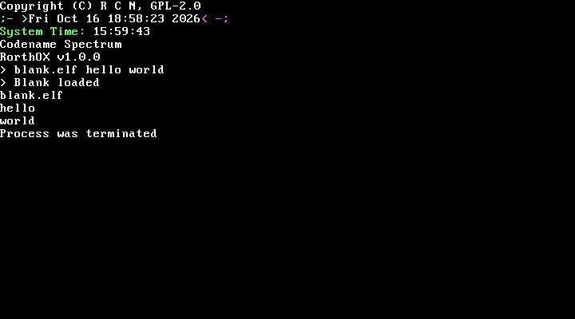
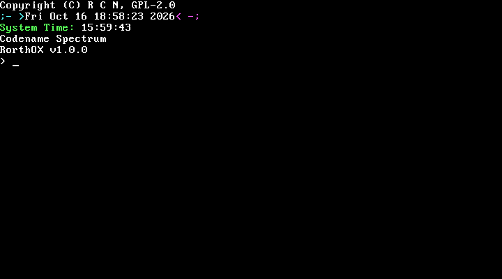
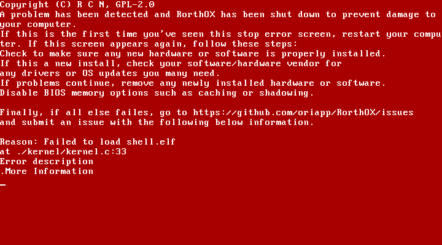
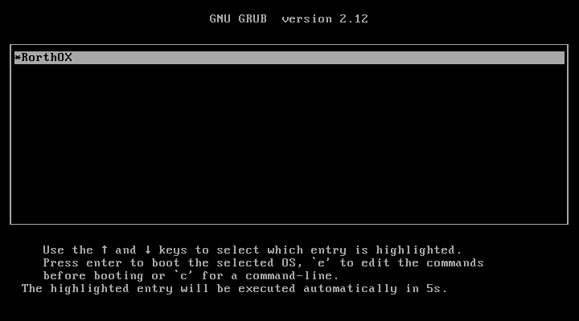

# RorthOX

RorthOX is my hobby operating system for 32-bit x86, written in C (gnu99, freestanding) and NASM. It boots from its
own boot sector or through GRUB and runs a small shell and user programs in ring 3, with paging, a FAT16 disk,
ELF loading, preemptive task switching and `int 0x80` syscalls. It's a learning project: small and
readable comes first, and it runs in QEMU (it has never been tried on real hardware).



| Boot | Kernel panic (here: no `shell.elf` on the disk) |
|---|---|
|  |  |



## What works

Everything in this list is checked by `make test` or was run in QEMU.

- **Boot:** a 512-byte boot sector with a FAT16 BPB sets up a flat GDT, enters protected mode and loads the kernel
  with ATA PIO to 1 MiB. The kernel clears its own `.bss` before any C code runs.
- **GRUB boot:** the same `kernel.bin` carries a Multiboot 1 header, and `make iso` builds a BIOS GRUB ISO with a
  one-entry menu. Programs still come from the FAT16 disk image.
- **CPU setup:** GDT with kernel/user code and data segments plus a 104-byte TSS, a 256-vector IDT, both 8259 PICs
  remapped (IRQs at 0x20-0x2F, only timer, keyboard and cascade unmasked), PIT at 100 Hz.
- **Exceptions:** a CPU exception in a user program ends only that program and the shell keeps working. An exception
  in kernel code stops the machine with a panic screen showing the reason and `file:line`, and one line on the debug
  port.
- **Memory:** a block allocator for the kernel heap (100 MiB, 4 KiB blocks) that refuses requests it can't satisfy, and
  one paging directory per process. Programs that exit give their memory back.
- **Disk and files:** ATA PIO (LBA28) reads with status checks, a path parser (`0:/dir/file`), a small VFS and a
  read-only FAT16 driver (8.3 names, subdirectories, cluster chains, `fopen`/`fread`/`fseek`/`fstat`/`fclose` in the
  kernel).
- **Programs:** ELF32 executables (each load segment gets its own zeroed memory, mapped writable only when the segment
  is) and flat binaries up to 1 MiB, loaded at 0x400000 and run in ring 3 with their own 16 KiB stack.
- **Tasks:** 12 process slots, a round-robin task switch on every timer tick, command-line arguments passed to
  `main(argc, argv)`.
- **Syscalls:** 12 calls through `int 0x80` (table below). Every argument and every string or list a syscall reads
  from user memory goes through a checked copy: only memory the program owns and has mapped, so a bad pointer can't
  crash the kernel. The call fails instead and the program carries on.
- **Console:** 80x25 VGA text with colours, scrolling and backspace across rows, and a kernel `printf`. Programs can
  move the cursor back and forth across rows without changing the text (syscall 11); a move off the visible page is
  refused. Kernel debug output also goes to port 0xE9 (QEMU's `debugcon`).
- **Keyboard:** PS/2 scancode set 1 with Shift symbols, Caps Lock and the keypad. Num Lock starts on, so the keypad
  types digits right away as before, whatever state the BIOS or GRUB left the keyboard in. The driver keeps track of
  it: with it off, the keypad digits and the decimal point type nothing, while keypad `+ - * /` and Enter still work. The arrows, Home, End, Insert, Delete, Page Up and Page Down arrive as their own key codes,
  0x100-0x109 (`KEY_*` in `config.mk`), whatever the Num Lock state. Print Screen and Pause type nothing.
- **Shell:** reads a line, splits it into words and runs the first word as a program (`blank.elf hello world`).
  While typing, Left/Right, Home/End, Backspace and Delete work anywhere in the line; Up, Down, Insert and the page
  keys are ignored. There are no built-in commands.
- **Program lookup:** syscalls 6 and 7 (and so the shell) look a bare program name (no `/` or `:`) up in the
  directories of `PROGRAM_SEARCH_PATHS` in `config.mk`, in order: by default `0:/` and then `0:/bin/`. The first
  directory that has the file wins. Only "not found" moves on to the next directory; a name that is there but can't
  be loaded (a directory, a broken ELF file, an empty or too big raw program) stops the lookup with an error. A name with a `/`
  or `:` is tried once, relative to `0:/` (`bin/x.elf` means `0:/bin/x.elf`; a drive prefix like `0:/x.elf` isn't
  understood). Names can be up to 104 characters, and `argv[0]` is the name as typed, not the full path. The image
  the build makes has no `bin/` directory: `shell.elf` and `blank.elf` are in the root.
- **User library:** `programs/stdlib` with the syscall wrappers, `malloc`/`free`, `printf`, `strtok`, `itoa`
  and a line reader with the editing keys above (`rorthox_terminal_readline`).

## Architecture

### Boot flow

The default path is my own boot sector:

1. The BIOS loads the boot sector (`kernel/boot/boot.asm`) to 0x7C00.
2. It loads a flat GDT, sets CR0.PE and far-jumps to 32-bit code.
3. It reads the kernel area (sectors 1-199, `RESERVED_SECTORS - 1`) from the primary ATA disk with PIO to 0x100000
   and jumps there.
4. `_start` (`kernel/kernel.asm`) loads the data segments, sets the stack to 0x200000, turns on A20 (port 0x92),
   clears `.bss`, remaps and masks both PICs and calls `kernel_main`.
5. `kernel_main` (`kernel/kernel.c`) sets up the terminal, GDT, kernel heap, filesystems, disk, IDT, PIT, TSS and
   paging, registers the syscalls and the keyboard, loads `0:/shell.elf` and drops into ring 3 with `iret`.

Interrupts stay off while the kernel runs. They are on only in user mode (`task_return` sets EFLAGS.IF), so every
timer tick, key press and syscall enters the kernel from ring 3.

The second path is GRUB (`make iso`, `./qemu.sh --iso`):

1. BIOS GRUB 2 boots from the CD and shows a menu with one entry and a 5-second timeout
   (`kernel/boot/grub.cfg.in`). The entry runs `multiboot /boot/kernel.bin`.
2. `kernel.bin` is still a flat binary. Its Multiboot 1 header (in `kernel/kernel.asm`, inside the first 8 KiB,
   checked by the linker script) uses the address fields, so GRUB loads the whole file at 0x100000, zeroes up to
   the end of `.bss` and jumps to `multiboot_entry`.
3. `multiboot_entry` checks the magic value in EAX, loads its own copy of the flat GDT, far-jumps to the kernel
   code segment, loads the data segments and sets the stack to 0x200000.
4. It then jumps to `kernel_boot_init`, the point in `_start` right after the A20 write (GRUB already turned A20
   on). From there both paths run the same code: clear `.bss`, set up the PICs, `kernel_main`.

The ISO holds only GRUB, `kernel.bin` and `grub.cfg`. Programs still come from the FAT16 disk `bin/os.bin`, which
has to be attached as the primary ATA disk. The Multiboot information GRUB passes in EBX isn't used yet.

### Memory map

All addresses are physical. The kernel and every process see an identity map of the full 4 GiB, with each process's
own program, stack and allocations mapped on top.

| Address | What |
|---|---|
| 0x7C00 | boot sector |
| 0x7E00-0xE1FF | kernel heap block table (one byte per 4 KiB block) |
| 0xB8000 | VGA text screen |
| 0x100000-0x10DB4B | kernel image (`kernel.bin`, 56,140 bytes; the disk reserves 101,888) |
| 0x10E000-0x11064B | kernel `.bss` |
| below 0x200000 | kernel boot stack (top 0x200000) |
| 0x3FB000-0x3FEFFF | user stack (virtual, 16 KiB, top 0x3FF000) |
| 0x400000-0x4FFFFF | user program load window (virtual) |
| 0x500000-0x5FFFFF | kernel stack for interrupts from ring 3 (TSS `esp0` = 0x600000) |
| 0x01000000-0x073FFFFF | kernel heap (100 MiB), so the machine needs 128 MiB of RAM |

The values shared between C, NASM, the linker scripts and the shell scripts live in one place, `config.mk`: among
others the syscall numbers and the codes of the special keys (`KEY_UP` = 0x100 to `KEY_PAGE_DOWN` = 0x109). It also
holds the program search list, `PROGRAM_SEARCH_PATHS`: 1 to 4 directory prefixes such as `0:/` or `0:/bin/`
(`0:/`, then simple directory names, each ending in `/`; disk 0 is the only disk). The build stops on anything else.

### Disk image

`bin/os.bin` is the boot sector, then `kernel.bin`, then 16 MiB of zeroes. The FAT16 layout comes from `config.mk`:

| Sectors | What |
|---|---|
| 0 | boot sector with the BPB |
| 1-199 | kernel area (`kernel.bin`; the build fails if it doesn't fit) |
| 200 onwards | FAT 1 and FAT 2 (256 sectors each), root directory, data |

The build copies `shell.elf` and `blank.elf` into the root directory with mtools, so no root access is needed.

### Subsystems

| Directory | What's in it |
|---|---|
| `kernel/boot` | boot sector, GRUB menu template |
| `kernel/kernel.asm`, `kernel/kernel.c` | entry points (`_start` and `multiboot_entry`), PIC setup, `kernel_main`, panic |
| `kernel/gdt`, `kernel/idt`, `kernel/task/tss.*` | descriptor tables, 256 interrupt stubs, TSS |
| `kernel/arch/i686` | VGA terminal and `printf`, debug port, panic screen, PIT driver |
| `kernel/memory` | heap allocator (`heap/`), paging (`paging/`) |
| `kernel/disk` | ATA PIO driver and byte streamer |
| `kernel/fs` | path parser, VFS, FAT16 |
| `kernel/loader/formats` | ELF32 loader |
| `kernel/task` | tasks, processes, switching to ring 3 |
| `kernel/isr80h` | the syscalls |
| `kernel/keyboard` | keyboard queue and the PS/2 driver |
| `kernel/time/rtc` | CMOS clock read at boot ("System Time") |

### Syscalls

A program puts the number in `eax`, pushes the arguments and runs `int 0x80`; the result comes back in `eax`. The
numbers are in `config.mk`, the handlers in `kernel/isr80h/`, the wrappers in `programs/stdlib/src/rorthox.asm`.

| # | User function | What it does |
|---|---|---|
| 0 | (no wrapper) | returns the sum of two integers |
| 1 | `print(str)` | prints a string (copied through a 1 KiB kernel buffer) |
| 2 | `rorthox_getkey()` | next key from the process's keyboard queue: a byte (1-255) or a special key code (0x100-0x109), 0 if there is none |
| 3 | `rorthox_putchar(c)` | prints one character |
| 4 | `rorthox_malloc(size)` | allocates kernel heap memory and maps it into the process |
| 5 | `rorthox_free(ptr)` | frees an allocation of the process |
| 6 | `rorthox_process_load_start(name)` | finds the program (see program lookup above), loads it and switches to it |
| 7 | `rorthox_system(args)` | runs a command from a list of arguments; the first word is looked up the same way (at most 32 words, program name included) |
| 8 | `rorthox_process_get_arguments(out)` | writes `argc`/`argv` into a writable struct the process owns |
| 9 | `rorthox_exit()` | ends the process |
| 10 | `printc(str, colour)` | prints a string in one of the 16 VGA colours |
| 11 | `rorthox_terminal_move_cursor(delta)` | moves the screen cursor by `delta` cells (negative = back, across rows) without changing the text; a move off the 80x25 page returns an error and changes nothing, it never scrolls |

## Building

You need Linux (or WSL on Windows), and an i686-elf cross compiler that `configure.sh` builds for you.

### Linux (Ubuntu 24.04)

```sh
sudo apt-get install -y build-essential bison flex libgmp3-dev libmpc-dev \
     libmpfr-dev texinfo curl xz-utils nasm qemu-system-x86 mtools python3
git clone https://github.com/oriapp/RorthOX.git
cd RorthOX
./configure.sh                            # builds binutils 2.42 + GCC 13.2 into ~/opt/cross
export PATH="$HOME/opt/cross/bin:$PATH"
make all
```

`configure.sh` takes a while the first time. Run again, it sees the installed toolchain and stops (`FORCE=1` rebuilds
it). `make all` gives:

| File | What |
|---|---|
| `bin/boot.bin` | the boot sector (512 bytes) |
| `bin/kernel.bin` | the kernel (56,140 bytes right now) |
| `bin/os.bin` | the disk image with `shell.elf` and `blank.elf` on it (16,833,868 bytes) |
| `bin/rorthox.iso` | the GRUB ISO, only with `make iso` (5,179,392 bytes) |

`./build.sh` does the same as `make all` and adds `~/opt/cross/bin` to the PATH itself. `./clean.sh` (or
`make clean`) removes the build output, and `./uninstall-config.sh` removes the toolchain again (it asks first and
leaves the apt packages alone).

### GRUB ISO (optional)

The ISO needs a few more packages. Don't install `grub-pc`: the ISO is BIOS-only and doesn't need it.

```sh
sudo apt-get install -y grub-common grub-pc-bin xorriso mtools
make iso                                  # bin/rorthox.iso, and bin/os.bin next to it
```

`./iso.sh` does the same and adds the cross compiler to the PATH. `make all` never needs GRUB. Without the
packages, `make iso` stops with a message that lists the missing tools and the line above.

### Windows

Use WSL 2 with Ubuntu 24.04 and follow the Linux steps inside it:

```sh
wsl -d Ubuntu
```

Clone into the Linux home directory (`~`). QEMU's window needs WSLg (Windows 11); without it, run headless with
`./qemu.sh -display none`.

## Running

```sh
./qemu.sh
```

This builds what changed and boots `bin/os.bin` in QEMU with 128 MiB of RAM. Kernel debug output (port 0xE9)
appears in the terminal. At the `>` prompt, type a program name with arguments:

```
> blank.elf hello world
```

Extra QEMU flags go after the script or in `QEMU_FLAGS`, for example without a window:

```sh
./qemu.sh -display none
QEMU_FLAGS="-display none" ./qemu.sh
```

Without the script:

```sh
qemu-system-i386 -m 128 -drive file=bin/os.bin,format=raw,index=0,media=disk -debugcon stdio
```

### Through GRUB

```sh
./qemu.sh --iso
```

This builds the ISO and boots it from the CD drive, with `bin/os.bin` still attached as the primary disk for the
programs. The GRUB menu boots RorthOX after 5 seconds, or straight away with Enter. `--iso` has to be the first
argument; QEMU flags go after it (`./qemu.sh --iso -display none`). Without the script:

```sh
qemu-system-i386 -m 128 -drive file=bin/os.bin,format=raw,index=0,media=disk \
    -cdrom bin/rorthox.iso -boot d -debugcon stdio
```

## Testing

```sh
make test
```

This builds everything and runs 56 tests (`scripts/smoke.sh` plus every `scripts/tests/*.sh`); it keeps going after a
failure and prints a summary (`56 passed, 0 failed, 0 skipped`). A full run takes about 10 minutes. `make smoke`
runs only the smoke test, and `./scripts/run-tests.sh scripts/tests/panic.sh` runs single tests.

The tests boot RorthOX headless in QEMU and drive it through the QEMU monitor: they type with `sendkey`, read the
screen straight from video memory and wait for text instead of sleeping. Some stop the CPU through QEMU's gdbstub to
check registers and memory, and some compile the real kernel source with the host C compiler (with AddressSanitizer
where it matters) to check one function against every input. Tests that need extra programs (`programs/*test*`,
`programs/syscheck` and so on) add them to a copy of `bin/os.bin`, never to the real image. Output goes to
`build/smoke/` and `build/tests/<name>/`.

| Area | Tests | What they prove |
|---|---|---|
| Boot and CPU setup | `smoke`, `kernel-bss`, `descriptor-tables`, `idt-load`, `interrupt-count`, `pic`, `pit`, `kernel-headers` | the shell boots and runs a program with arguments; `.bss` is zero before C; GDT/TSS layout and limits; 256 IDT vectors; PIC remap and masks; PIT at 100 Hz and the tick order |
| GRUB boot | `multiboot-header`, `grub-boot` | the Multiboot header fields and their bounds in `kernel.bin` (no QEMU needed); the ISO boots through the GRUB menu and runs `blank.elf`, and a second boot from a disk whose boot sector only loops checks through QEMU's gdbstub that the Multiboot entry, not the boot sector, sets up the GDT, segments and stack |
| Exceptions and privilege | `exception-frames`, `exceptions`, `kernel-exceptions`, `panic`, `panic-screen`, `task-flags`, `tss-io` | one frame layout for every vector; only the syscall and debugging gates are open to ring 3; a user fault ends only that program; kernel faults panic and stay halted; each task keeps its EFLAGS; ring 3 can't touch I/O ports |
| Memory | `heap`, `heap-free`, `heap-oom`, `print-oom` | oversized requests fail; bad frees are ignored; running out of heap while starting a program is an error, not a crash |
| Disk and FAT16 | `disk-read`, `fat-chain`, `fat-directory`, `fat-entry`, `fat-lookup`, `file-descriptors`, `file-read`, `path-release`, `open-oom` | ATA status checks; cluster chains; reserved and bad FAT values; lookups and seeks stay in bounds; a missing file is told apart from other open errors; every descriptor slot works; failed opens give their memory back |
| Programs and processes | `elf-segments`, `elf-unwind`, `raw-program`, `load-unwind`, `process-release`, `task-list`, `syscall-path`, `program-arguments`, `command-arguments`, `argument-oom`, `user-pointers`, `program-lookup`, `program-lookup-config`, `config-values` | ELF segments get their own memory; bad ELF files are refused; raw programs must fit the load window; failed loads give everything back; finished programs free their memory; the task list stays linked; every syscall checks the user memory it reads or writes; bare names are looked up in the search list in order, the first match wins, only a missing file moves on, and `argv[0]` stays as typed; bad `PROGRAM_SEARCH_PATHS` values stop the build, and so do key codes outside 0x100-0xFFFF and duplicate key codes or syscall numbers in `config.mk` |
| Console, keyboard, user library | `tty-scroll`, `tty-backspace`, `printc`, `formatting`, `keyboard-burst`, `keyboard-queue`, `keyboard-scancode`, `keyboard-symbols`, `keyboard-extended`, `readline`, `readline-edit`, `strtok` | scrolling and backspace; colours, and the key and cursor syscalls pass their values whole; bounded formatting; no lost keys; a full key queue keeps unread keys and every key value comes back unchanged; the decoder for every key with Shift, Caps and Num Lock, plus the E0/E1 sequences (fake shifts, Print Screen, Pause); the special keys and Num Lock as QEMU sends them; cursor moves stay on the page and change no text; line editing in the middle of a line, across a row edge and while the screen scrolls; `strtok` |

`grub-boot` needs the GRUB packages. Without them it is reported as skipped (`1 skipped` and a `SKIPPED:` line)
instead of failing; `RORTHOX_REQUIRE_ISO=1 make test` turns that into a failure.

CI (`.github/workflows/build.yml`) installs the packages including GRUB, builds the toolchain (cached), runs
`make all iso` and `RORTHOX_REQUIRE_ISO=1 make test` on Ubuntu 24.04 for every push, and keeps the disk image, the
ISO and the test output as artifacts.

## Project layout

```
kernel/            the kernel (boot sector, entry, drivers, memory, filesystems, loader, tasks, syscalls)
kernel/boot/grub.cfg.in   the GRUB menu for the ISO
programs/stdlib/   user-space runtime and syscall wrappers
programs/shell/    the shell
programs/blank/    a small program that prints its arguments
programs/*/        test-only programs, used by scripts/tests/ on a copy of the disk image
scripts/           smoke test, test runner, QEMU helpers (qemu-lib.sh), ISO tool check (check-iso-tools.sh)
scripts/tests/     the tests; host/ has the host C checks, lib/ the Python and gdbstub helpers
config.mk          shared values: disk layout, addresses, selectors, syscall numbers, key codes, program search list, RAM size
Makefile           builds bin/boot.bin, bin/kernel.bin and bin/os.bin; make iso, make test, make smoke
configure.sh       builds the i686-elf cross toolchain
build.sh, qemu.sh, clean.sh, uninstall-config.sh   small wrappers
iso.sh             make iso with the cross compiler on the PATH
```

## Known limitations

RorthOX is not a secure system. It has some targeted checks, but no real isolation between programs or between a
program and the kernel.

- **No process isolation.** Every task's page tables start with a read-only, user-readable identity map of all
  4 GiB, so a program can read kernel memory and other programs' memory. CR0.WP is off, and turning it on needs a
  change to how the interrupt stack is mapped. (The IDT gates and the TSS descriptor are DPL 0, except the syscall
  and the `int3`/`into` debugging traps, so a program can't raise an IRQ or another exception vector with `int`:
  it gets a #GP instead.)
- **Command length.** A command with more than 32 words (program name included) is refused. The shell doesn't print
  errors, so it just shows a new prompt.
- **Resources.** There's no per-process memory limit: one program can take most of the kernel heap. Raw programs
  must be 1 byte to 1 MiB; ELF files get a kernel buffer as big as the file.
- **Keyboard.** The per-process key queue holds 1024 unread keys; more are dropped. The keyboard LEDs aren't set,
  so the Num Lock light can disagree with the state the driver keeps. With Num Lock off the keypad keys don't act as
  arrows, Home and so on (they type nothing), and Shift doesn't flip the keypad between digits and those keys.
  The driver drops the two bytes after each E1 (Pause), so a cut-off Pause sequence swallows up to two real key bytes.
- **Line editing.** The line reader returns on its own, as if Enter was pressed, once the caller's buffer is full.
  With echo on it also stops at 1023 characters; without echo only the buffer size limits it. There's no history,
  no overwrite mode and no scrolling inside a line: the whole line has to stay on the visible page. The screen is
  shared, so if another program prints while a line is being edited, the echo and the cursor get out of step with
  the line.
- **One shared screen.** There's no per-program console: any program can move the cursor anywhere on the page
  (syscall 11) and overwrite text that the kernel or another program printed.
- **Program lookup.** The search list is fixed when the kernel is built. There's no current directory and no
  environment, so there's no `PATH` to change at run time.
- **Filesystem.** FAT16 is read-only, 8.3 names only, and only the kernel can open files (there's no file syscall).
  A crafted disk image can make it scan for a long time; cluster chains aren't checked for loops.
- **No FPU state per process.** x87 registers aren't saved or reset between tasks.
- **Fixed memory layout.** The kernel heap is at 16 MiB and the machine needs 128 MiB of RAM; there's no BIOS
  memory map, and the one GRUB passes is ignored. The boot sector loads the kernel to 1 MiB before `_start` enables
  A20, so it relies on the firmware having A20 on (QEMU's does).
- **Small things.** `pit_sleep` exists but can't be used from kernel code yet (the tick switches tasks). Kernel
  `vsprintf`/`sprintf` are unbounded (no code that runs calls them). The boot clock prints minutes and seconds without
  leading zeros.
- **GRUB path is BIOS only.** No UEFI, and the ISO has only been booted in QEMU (not VirtualBox, not from USB).
- **Tested only in QEMU** (8.2, TCG). It has never run on real hardware.

## Roadmap

Parts that are started but not finished:

- **Isolation:** stop mapping all of memory into every process, and turn on CR0.WP.
- **Writing files:** the VFS has write and append modes, but FAT16 refuses anything but read, and there are no file
  syscalls yet.
- **Sleeping:** `pit_sleep` is there, but kernel code can't use it until the tick stops switching tasks under it.
- **Real hardware:** never tried.

## Licence

RorthOX is licensed under the GNU General Public License v2.0, see [LICENSE](LICENSE).
Copyright (C) R C N.
